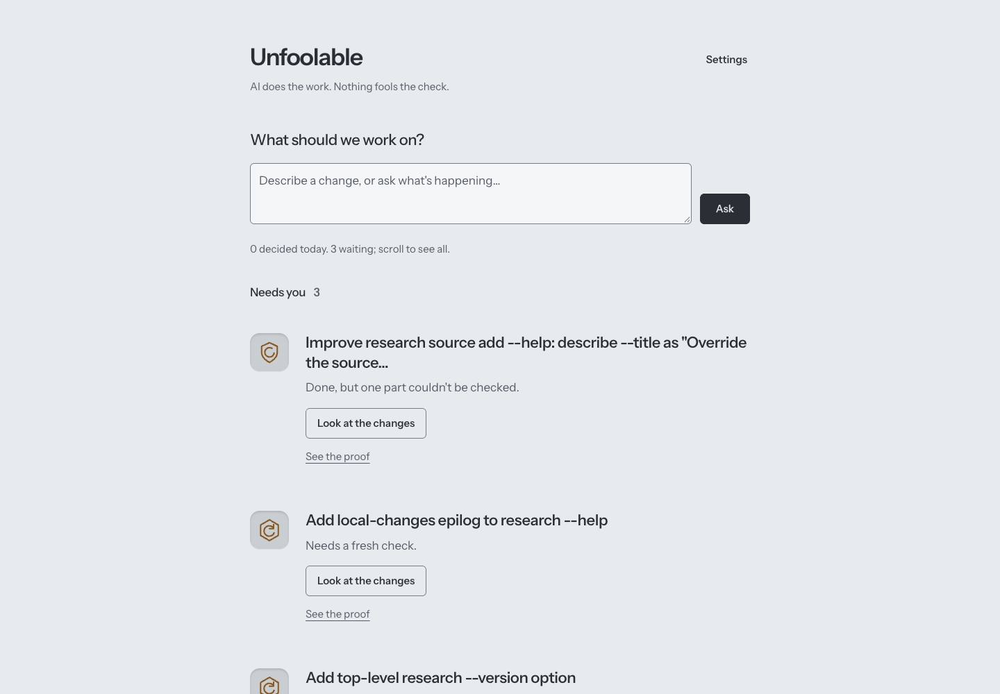
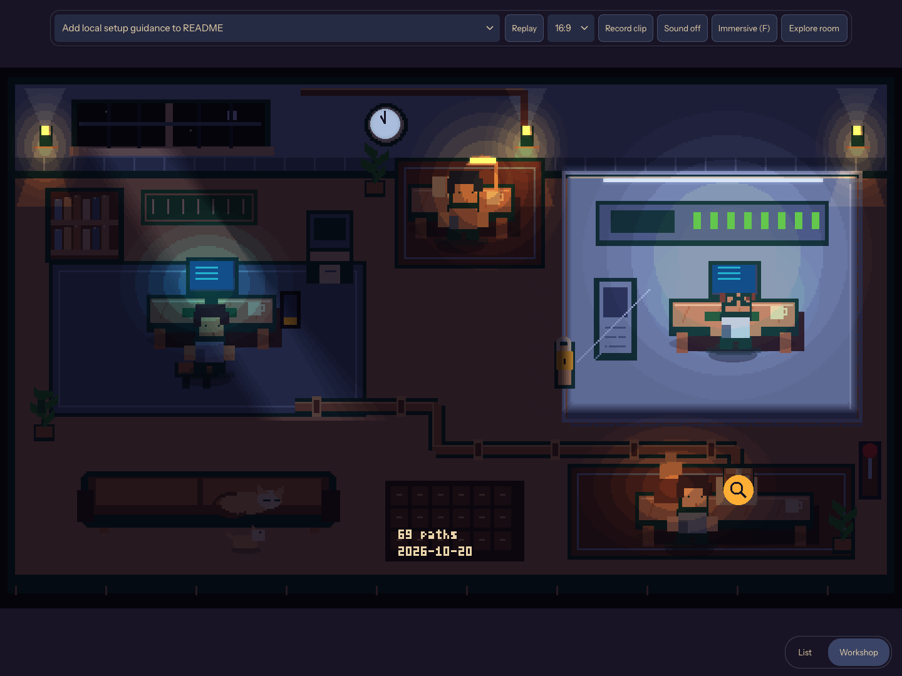
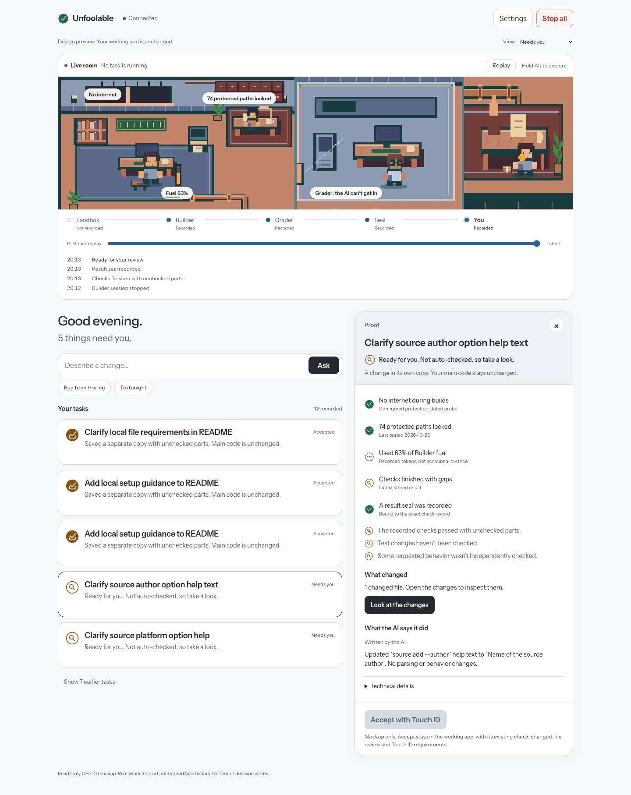

# Unfoolable

**AI does the work. Nothing fools the check.**

Unfoolable is a personal, local Mac app. Describe a code change, review the proposed task, and let Codex work in a separate copy. Protected checks report what passed and what could not be checked. You decide whether to Accept or Reject. Accept saves a separate local branch; it never merges or pushes.



*UI-4 replay of recorded local tasks, not a claim about current live counts.*

## Start

Requirements: **macOS, Node 24, Git, and Codex authenticated with your existing ChatGPT account**. The sandbox and Touch ID flow are built for the Mac; this is not a cross-platform setup.

```sh
git clone https://github.com/jeshwanthsingh/Unfoolable.git
cd Unfoolable
npm ci
./cc chat
```

The launcher starts the coordinator, browser UI and live event stream, then opens your private page. On this Mac, the installed `unfool` alias does the same thing; cloning alone does not install that alias. Open the app through the launcher to connect the private screen.

Register your passkey in the local UI. Starting work and making decisions require fresh Touch ID confirmation; nothing is accepted automatically. Project checks need a one-time approved playbook. No new paid API billing is required; Codex uses your existing account allowance.

To investigate an error, paste its traceback in Ask, or run `./cc bug error.log`. Logs are bounded and scanned for secrets before AI sees them. The first session may only write a reproduction test; a fix starts only after that test produces the matching failure on the original code. Initial matching support is Python unittest. Unsupported or unreproduced reports stop honestly.

## Optional Workshop

Choose **Workshop** beside **List** for an optional full-window pixel room. The Builder, protected Grader, Test Writer and your stamp desk reflect recorded task events. Tappable objects explain the sandbox, protected paths, budget and review flow, with their data sources. Local time sets the daylight or lamp-lit night scene; ambient character motion is decorative, never evidence of work.

**Replay** compresses a real ticket's event history into a 38-second trailer, with inactive stretches labelled as fast-forwarded. **Record clip** saves a local WebM and metadata without uploading anything. Replay cannot make decisions. Phone and reduced-motion views use a still illustration; the main task list remains the default.



[Landscape demo](artifacts/office3/workshop-16x9.webm) · [Vertical demo](artifacts/office3/workshop-9x16.webm) · [Implementation, verification and limits](artifacts/office3/RESULT.md).

## Observatory preview — awaiting approval

The proposed next main screen combines a live Workshop strip, an event-based journey and task list, and a Proof pass that opens beside the task (a swipeable sheet on phone). It uses the real Workshop art and stored task history. **This is a separate, read-only design preview; it has not replaced the working app.** Ask, Stop all and decision controls cannot change real work in the preview. The working app's Touch ID and review requirements are unchanged.



[Light/dark desktop and phone mockups](artifacts/obs0/INDEX.md) · [20-second recorded-task replay](artifacts/obs0/replay-20s.webm) · [Real event map](docs/OBS_0_EVENT_MAP.md) · [Design tokens and motion rules](docs/DESIGN_SYSTEM.md).

With the normal app already running, start the preview separately:

```sh
npm ci --prefix docs/mockups/observatory --legacy-peer-deps --ignore-scripts
npm run dev --prefix docs/mockups/observatory
# In another terminal, connect the private preview without printing its key:
node docs/mockups/observatory/open.mjs
```

The preview opens at `http://localhost:3260/`; the normal app remains on its existing port. No failed-check, production read-alarm or Night Shift morning record exists in the captured ticket data, so those views say so instead of inventing activity. The 74-path protection label is dated probe evidence, not 74 separate secrets or a per-task test. Preview checks: **9/9 tests**, strict typechecks and build passed; **644 existing application/script/test files unchanged**. The production suite was not rerun for this isolated mockup. [Full preview report and limits](artifacts/obs0/RESULT.md).

## On your iPhone

Install and connect Tailscale on both devices using your own account. On the Mac run `./cc phone serve`, then open Settings → Add my phone. Scan the five-minute QR code, create the phone passkey, and confirm the matching phone on the Mac with Touch ID. Add the private HTTPS page to your iPhone Home Screen for optional alerts. The app stays on loopback; Tailscale Serve is private, never Funnel. Phone decisions require a fresh passkey check. [Phone setup and limits](docs/PHONE_1.md).

## What the measurements say

| Measurement | Observed result |
| --- | --- |
| Planted cheats kept from passing | **12/12**: 5 failed, 7 inconclusive |
| False accepts on the eight-wrong-change scoring set | **0/8** |
| Correct changes confirmed by the earlier native Test Writer | **4/11** |
| Latest bounded-context confirmation study | **2/11 (18.2%)** |
| Six historical correct fixes confirmed | **1/6 (16.7%)** |

These are small local studies. Zero false accepts includes abstentions; it does not mean every defect was detected. The historical tasks are correlated, and four historical artifacts were blocked by the harness. The Test Writer missed its promotion bar and remains **advisory only**. [Measured results and limits](artifacts/warning-signal/RESULT.md), [earlier native-test study](artifacts/test-writer-v2/RESULT.md).

## Safety in six points

- The Builder uses an isolated copy, cannot read protected checks or private folders, and has no outside network.
- The checker restores the original tests before checking the frozen change. Edited tests cannot quietly replace them; zero tests never pass.
- Reusable project checks need approval. A regression check applies only if it passes on that change's starting version.
- The independent Test Writer sees original code, not the proposed change. Its warnings cannot erase a failing protected check.
- Accept needs a fresh Touch ID confirmation tied to the exact change. Flagged work requires looking at every changed file; stale buttons are rejected.
- Work and decisions are recorded as events. Fixes are bounded, restart interrupts unfinished work, and Stop all needs no approval.

## Known limits

Passing existing tests does not prove new behavior. A result with unchecked behavior is a gap, not a clean bill of health. Native tests share a process with the code they test; deliberate in-memory or observation-channel forgery remains a risk. Tripwire alarms are best effort. There has been no full manual screen-reader audit. Physical-iPhone performance and a complete real-device pairing exercise are not established by desktop browser tests.

Backups are local and same-disk, not disaster protection. [Backup and restore](docs/BACKUPS.md). The repository is still named `command-center`. Older orchestration screens are experimental. [Handoff](HANDOFF.md) explains operation, tests and open work; [DESIGN.md](DESIGN.md) is a factual outline for the owner to expand.

Skill imports: `./cc skill add /absolute/path/to/a/skill` scans a frozen copy with the pinned local SkillSpector, static only and offline. High-risk imports remain uninstalled until an exact-content Touch ID confirmation. Existing skills rated “do not install” are disabled with files retained; see the UI-5b scan report. Static findings are warnings, not proof of malicious intent.

## Development and verification

```sh
npm run dev        # Local server and Vite frontend
npm test           # Automated tests; Node 24 required
npm run typecheck
npm run build
```

HTTP and process-ownership tests need an environment that permits local listeners and process inspection. Do not interpret sandbox-denied test infrastructure as a passing run. The latest recorded production repair passed **1,200/1,200 tests**, with no failures or skips, and **61 current-policy replay comparisons with zero differences**. [Repair results](artifacts/urgent-workshop/validation.json). Protected-read probes and planted-cheat results are dated evidence in their round reports, not checks automatically rerun when you clone. [Latest recorded 74-path probe](artifacts/rules1/protected-probe.json), [planted-cheat results](artifacts/rules1/negative-controls.json).

Keep live SQLite data, local tools and credentials out of Git. Do not delete `.work/` wholesale: on the configured Mac it contains live application data. [Operational handoff](HANDOFF.md) and [backup instructions](docs/BACKUPS.md) cover the existing installation.
