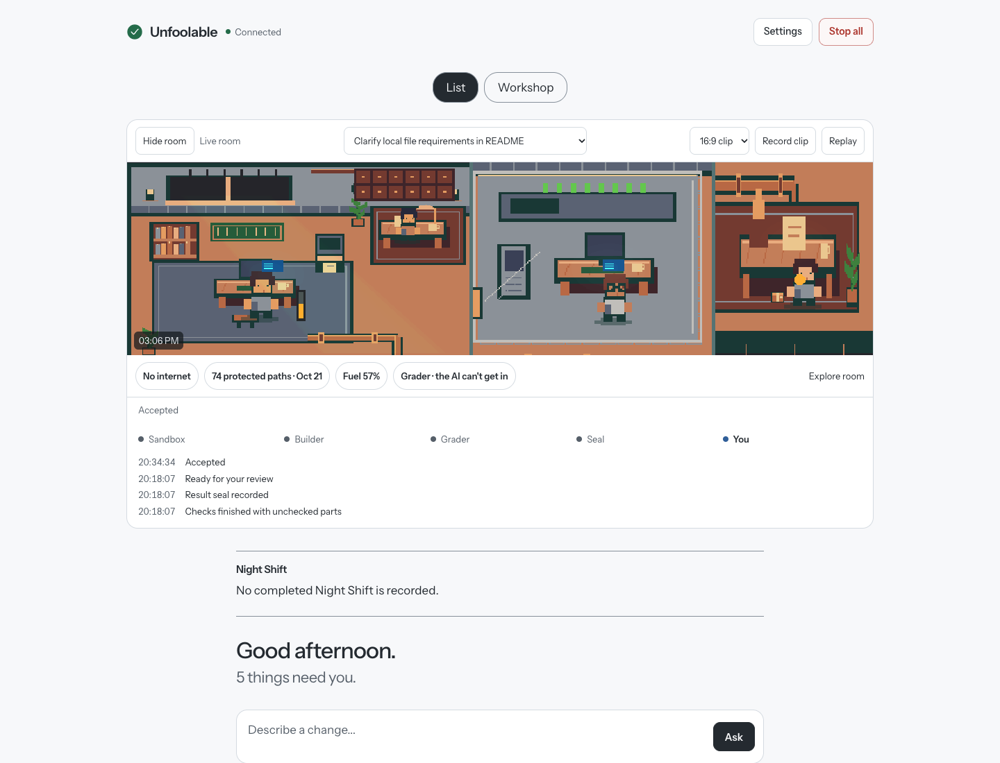
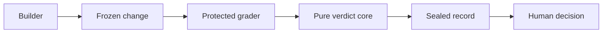

# Unfoolable

**AI does the work. Nothing fools the check.**

A local Mac workflow where the coding agent does the work but is never the authority on whether it passed.

  

<a href="artifacts/obs3/replay-landscape.mp4"></a>

**[Watch a recorded task replay](artifacts/obs3/replay-landscape.mp4)** · [Portrait version](artifacts/obs3/replay-portrait.mp4) · [Recording sources and limitations](artifacts/obs3/RESULT.md)

## The worker doesn't get to be the judge

Coding agents can change tests, miss an edge case or simply say “done.” Unfoolable puts an independent checking boundary between that claim and your decision.

Describe a change. Codex works in a separate copy of your project. Protected checks inspect the frozen result and report what passed, failed or couldn't be checked. You see the changes and decide whether to keep them.

**Nothing is accepted automatically. Accept saves a separate local branch. It never merges or pushes.**


*The room follows recorded events. Replays are labelled; missing data stays unknown. The screenshot shows a saved task, not current live counts.*

## How it works

1. **Ask.** Describe the change and confirm the exact task with Touch ID.
2. **Build.** Codex works in its own sandboxed copy, with outside network access and protected-file reads denied.
3. **Freeze.** Unfoolable snapshots the result and restores the original tests for checking.
4. **Check.** Approved project checks and local quality tools feed one pure verdict function.
5. **Seal.** The Mac signs the facts, result and trace. Verification can replay the recorded core version later.
6. **Decide.** Open every changed file, then Accept or Reject with a fresh confirmation.



## What the measurements actually say

| Earlier local study | Result |
| --- | --- |
| Planted cheats kept from passing | **12/12** — 5 failed, 7 inconclusive |
| Wrong changes falsely accepted | **0/8** |
| Correct changes confirmed in the bounded-context study | **2/11 (18.2%)** |
| Correct historical fixes confirmed | **1/6 (16.7%)** |

Zero false accepts includes abstentions. It does **not** mean every defect was detected. These are small, correlated studies; four historical artifacts were blocked by the test harness. The independent Test Writer missed its promotion bar and remains advisory.

[Read the methods, denominators and limitations](artifacts/warning-signal/RESULT.md).

Current installation snapshot (2026-10-24): **78 protected targets** in `protected-paths-v1`; **6 sealed / 0 broken** latest ticket records, with 8 older records explicitly unsealed. Released verdict cores v1/v2 preserve old replay. SCION-1 adds deterministic change classification, raise-only review rules and idle/AC-only self-checks. New seal format v2 binds the request hash and recorded Builder identity. These are dated observations, not promises about another installation. [ADV-1 status and remaining gaps](docs/ADV_1_STATUS.md).

## Run it on your Mac

Requires **macOS, Node 24, Git and an authenticated Codex account**. Work uses your existing Codex allowance; no separate paid API key is required.

```sh
git clone https://github.com/jeshwanthsingh/Unfoolable.git
cd Unfoolable
npm ci
./cc chat
```

One command starts the coordinator, web UI and event stream, then opens your private page. If you already have the `unfool` alias installed, it does the same thing. Register a passkey in Settings, then approve your project's checks before its first run.

The app also supports **Bug from this log**, which requires a matching reproduction before fixing, and **Night Shift**, which queues individually approved tasks and leaves the results for your review.

## What it does not claim

“Unfoolable” is an aspiration, not a guarantee. The host Mac is trusted. Native tests share a process with the code they test, so deliberate in-process result forgery remains a known risk. Passing old tests doesn't prove every new behavior; gaps stay visible. A seal proves record integrity, not code correctness or host honesty.

This is a personal, single-Mac tool. Real-iPhone and VoiceOver testing remain limited. Tripwire alarms are best effort; the sandbox is the enforced read boundary.

[Design](DESIGN.md) · [Threat model](docs/THREAT_MODEL.md) · [Negative controls](docs/NEGATIVE_CONTROLS.md) · [Architecture facts](docs/DESIGN_FACTS.md) · [Signing](docs/SIGNING.md) · [Invariants and their tests](docs/INVARIANTS.md) · [Backups](docs/BACKUPS.md)

## Development

```sh
npm test
npm run typecheck
npm run build
```

Some boundary tests need macOS and must run outside an enclosing sandbox. Historical reports are dated evidence, not checks automatically rerun by cloning.

**Companion project:** [Aegis](https://github.com/jeshwanthsingh/aegis) contains untrusted code in Firecracker microVMs. **Aegis contains, Unfoolable judges.**
