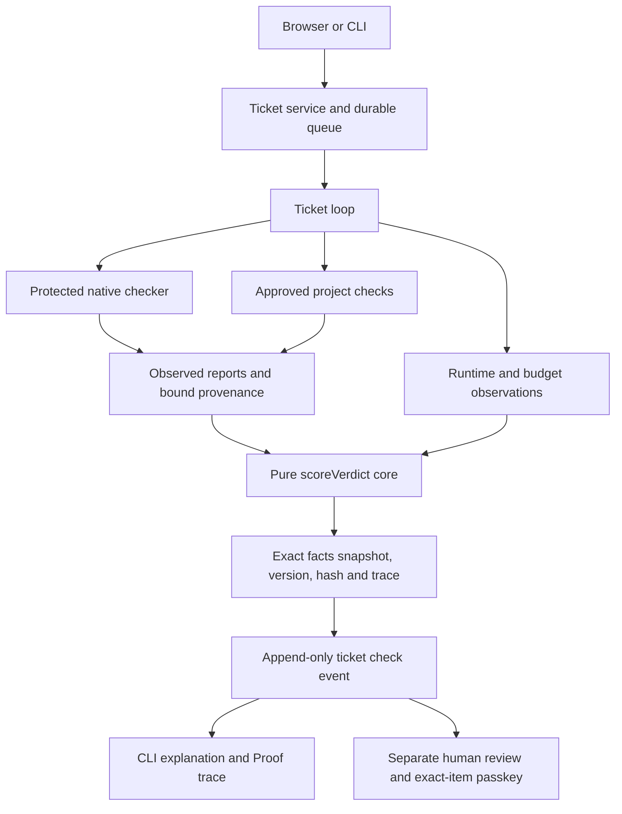
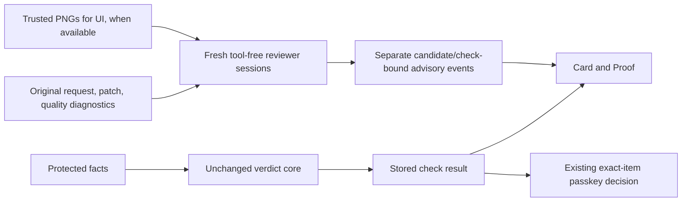
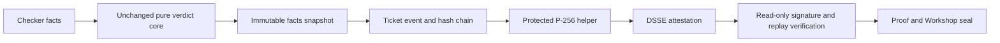

# Design facts

CORE-1 source at `14a6857`. Pre-refactor server/shared source in the original graph snapshot `d8c0752` is identical to `3c94150`. Graphify 0.9.92 supplies navigational AST relations, supplemented by source review and tests.

## Components and data flow

- `packages/shared/verdict-core.ts` is a 135-line pure module. `scoreVerdict` contains native and project aggregate rules, required-claim precedence, compatibility adaptation, their caution-order combination, runtime/budget classification and independent-test admission. `combineResults` delegates to the same function.
- `scoreV1`, `scoreVerifyV2`, ticket checker, project checker and runtime shell call this core. `isV1Report` checks structure only; public view validation explicitly checks semantic consistency through scoring.
- Collectors still execute tools, restore BASE tests, admit project commands, inspect quality/tamper reports, count usage and measure deadlines. Tool assertions, safe exports, process cleanup and human-review restrictions remain enforced outside the core.
- A supplied aggregate is accepted only on the internal native-ticket fact path, with protected-verifier ID and evidence-hash provenance. The live supplier is `createVerifyOnly` via create/createTicketCandidate/wait; historical replay reads its saved result. Builder prose is never a supplier. The empty-layer compatibility rule deliberately preserves old behavior; tightening it is proposed separately, not applied.
- `verdict-snapshot.ts` saves exact facts and core identity with content hashes and immutable files before publishing a production verdict. Snapshot failures cannot publish success. The evaluator bundle includes core and snapshot source, so policy changes invalidate existing freshness.
- `explainTicket` selects the highest-sequence check_result. CLI and Proof show that event number and its stored label; retained facts can explain current policy without changing historical labels. b15600b3's latest check is 664 (PASSED WITH GAPS), not 592 (NOT CHECKED). The earlier policy annotation remains separate.

## Trust boundaries

The Builder and protected checker remain separate processes with existing denial profiles. The pure core trusts its input observations; it cannot turn an untrusted in-process observation into a secure channel. Runtime, filesystem and process code never enter the core. Human Keep still needs current exact-item Touch ID and required diff viewing. Scoring never accepts a change on the owner's behalf. The provenance fields are origin metadata, not a signature.

## Measurements

The same dependency closure is 148 files / 3,982 edges before and 151 / 4,086 after. This includes collectors, types, observers and new snapshot/explanation shells. Source-reviewed aggregate decision authorities are separately 8 files / 8 functions before and 1 file / 1 deciding function after; delegation-only wrappers are excluded. See `artifacts/core1/graph/rule-authorities.json` for scope, entries and exclusions. Upstream layer constructors and diagnostic/admission checks are not claimed to have disappeared.

All 15 reconstructible historical results match actual 3c94150 code on identical facts. Four earlier events lack replay inputs; they remain historical records, not manufactured comparisons. The original golden archive and stored verdicts are unchanged.

## Graph and evidence limits

`before.html` / `after.html`, `before.png` / `after.png`, the readable overview images, manifests, counts and path-query output are under `artifacts/core1/graph/`. The core has no outgoing external import/call edges; the pinned TypeScript authority lint independently rejects imports and ambient side effects. Graphify's partial parsing and injected callbacks limit graph completeness; a missing edge is not an enforcement proof. CLI-only code extraction runs under deny-network, isolated HOME and no provider keys. The static skill scan was DO_NOT_INSTALL, so no Graphify skill or MCP/HTTP server was installed.

## REVIEW-1 advisory side channel

The protected verdict core, scorer wrappers and judge code retain their fbad889 hashes. After a check is recorded, the coordinator may schedule independent advisory reviewers. `DEFAULT_REVIEWERS` remains empty. REVIEW-1b uses the saved study only: both text reviewers flag the same five wrong study cases with zero false alarms, but no unique contribution beyond both Test Writer and quality gates is proven (gates were not measured). See REVIEWERS.md. Structurally valid out-of-patch notes are discarded individually; all-discarded output is Review incomplete. Discard events are advisory and excluded from decision bindings. `skipReviewers` is an optional approved-playbook opt-out; omitting it preserves existing hashes.

Reviewer output never enters core facts, review-risk colors, check evidence or decision binding. Each role has a 15,000-token budget and a separate fresh read-only session; no file/network/write tools are exposed. Missing screenshots or invalid output remain unavailable, not passing. Cancellation is separate from Builder budgets. The display channel is filtered from confirmation state solely to preserve existing bindings; all original state/check inputs remain authoritative. UI image transport was smoke-tested; the frozen study had no eligible visual patches and UI remains uncalibrated/off. The Workshop therefore retains its existing desks.

## SIGN-1 sealed records

- Verdict-core.ts is unchanged from fbad889. Both existing result paths still supply exactly the same facts and decisions.
- After a check result is recorded, the trusted host shell binds its event ID, stored facts/trace, core source, BASE, frozen diff and pinned gate-tool metadata into an in-toto Statement v1 / DSSE envelope. Only a successful signature emits verdict_sealed.
- Migration 21 adds a global ticket-event hash chain, its origin/head, attestation storage and seal-error storage. Pre-migration events retain their exact bytes and remain unsealed. Event, chain, seal and display marker publication use one SQLite savepoint.
- The current signer is a protected 0600 P-256 file fallback. The unsigned Swift/CryptoKit feasibility compile failed because Xcode's licence is unaccepted; no special entitlement or licence acceptance was added. Hardware feasibility remains unknown.
- The helper runs no Candidate code, receives only a bounded DSSE message, and has no network or agent-tool API. Real pinned Builder read/exec probes deny the key and helper (71-path corpus).
- Production verification pins docs/VERIFY_KEY.pem. Isolated TEST databases use isolated test keys. cc verify returns 0 only for sealed, replaying results; 1 for breaks; 2 for older/unsealed records. It is read-only and never accepts a change.
- Backup manifests and last-success checkpoints retain the chain head; SQLite replication retains its table. Facts, immutable diff bytes, signatures and signing identity are included in protected file checkpoints.
- Proof shows seal/replay status separately from the unchanged verdict. The Workshop wax press uses matching signed events plus the verified read-only detail status; missing state stays unknown and broken state is red.

A seal authenticates the stored result, including failures or gaps. It is not additional test coverage. Hash chains/signatures are checked against retained anchors and the trusted key; whole-machine rollback and an owner/root attacker replacing code/keys are outside this local boundary.

## SIGN-1b active hardware sealing

- Migration 21 is active on the owned local coordinator. Fresh backup and full restore were proven before activation; historical checks remain unsealed.
- The Swift CryptoKit helper signs with SecureEnclave.P256, AfterFirstUnlockThisDeviceOnly/privateKeyUsage, no biometric/user-presence requirement and no special entitlement. Only the device-bound blob is stored; Builder read and helper execution are denied.
- DSSE key IDs select public keys from docs/VERIFY_KEYS.json. Signed timestamps must fall within the selected key's validity interval. Retirement does not rewrite old envelopes or core verdicts.
- The local legacy private.pem was overwritten/fsynced/unlinked after hardware proof and restart. Exact private/blob backup paths are excluded; older backups/snapshots may retain the software key. Public keys remain available for historical verification on a new Mac.
- Key provisioning/rotation requires exclusive coordinator ownership. No verdict-core, scoring, approval, passkey or Keep rule changed.
