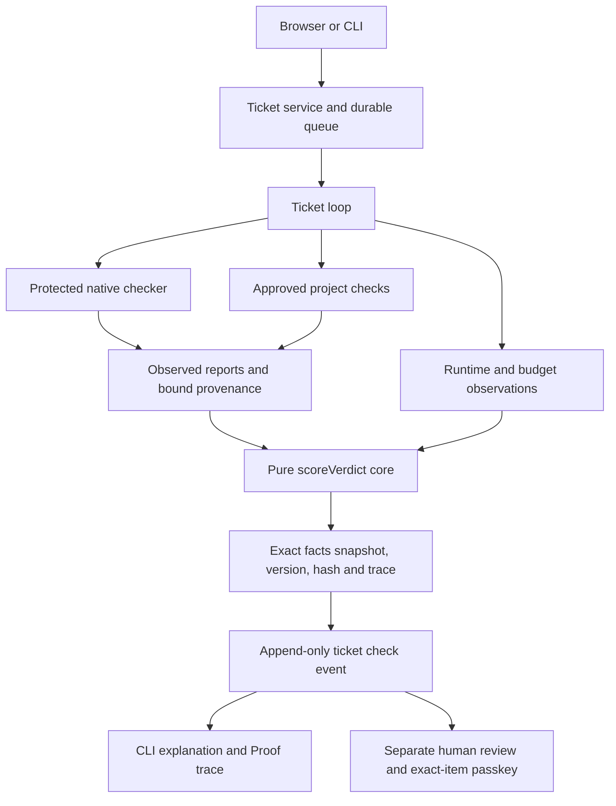

# Design facts

CORE-1 source at `14a6857`. Pre-refactor server/shared source in the original graph snapshot `d8c0752` is identical to `3c94150`. Graphify 0.9.92 supplies navigational AST relations, supplemented by source review and tests.

## Components and data flow

- `packages/shared/verdict-core.ts` is a 135-line pure module. `scoreVerdict` contains native and project aggregate rules, required-claim precedence, compatibility adaptation, their caution-order combination, runtime/budget classification and independent-test admission. `combineResults` delegates to the same function.
- `scoreV1`, `scoreVerifyV2`, ticket checker, project checker and runtime shell call this core. `isV1Report` checks structure only; public view validation explicitly checks semantic consistency through scoring.
- Collectors still execute tools, restore BASE tests, admit project commands, inspect quality/tamper reports, count usage and measure deadlines. Tool assertions, safe exports, process cleanup and human-review restrictions remain enforced outside the core.
- A supplied aggregate is accepted only on the internal native-ticket fact path, with protected-verifier ID and evidence-hash provenance. The live supplier is `createVerifyOnly` via create/createTicketCandidate/wait; historical replay reads its saved result. Builder prose is never a supplier. The empty-layer compatibility rule deliberately preserves old behavior; tightening it is proposed separately, not applied.
- `verdict-snapshot.ts` saves exact facts and core identity with content hashes and immutable files before publishing a production verdict. Snapshot failures cannot publish success. The evaluator bundle includes core and snapshot source, so policy changes invalidate existing freshness.
- `explainTicket` selects the highest-sequence check_result. CLI and Proof show that event number and its stored label; retained facts can explain current policy without changing historical labels. b15600b3's latest check is 664 (PASSED WITH GAPS), not 592 (NOT CHECKED). The earlier policy annotation remains separate.

## Trust boundaries

The Builder and protected checker remain separate processes with existing denial profiles. The pure core trusts its input observations; it cannot turn an untrusted in-process observation into a secure channel. Runtime, filesystem and process code never enter the core. Human Keep still needs current exact-item Touch ID and required diff viewing. Scoring never accepts a change on the owner's behalf. The provenance fields are origin metadata, not a signature.

## Measurements

The same dependency closure is 148 files / 3,982 edges before and 151 / 4,086 after. This includes collectors, types, observers and new snapshot/explanation shells. Source-reviewed aggregate decision authorities are separately 8 files / 8 functions before and 1 file / 1 deciding function after; delegation-only wrappers are excluded. See `artifacts/core1/graph/rule-authorities.json` for scope, entries and exclusions. Upstream layer constructors and diagnostic/admission checks are not claimed to have disappeared.

All 15 reconstructible historical results match actual 3c94150 code on identical facts. Four earlier events lack replay inputs; they remain historical records, not manufactured comparisons. The original golden archive and stored verdicts are unchanged.

## Graph and evidence limits

`before.html` / `after.html`, `before.png` / `after.png`, the readable overview images, manifests, counts and path-query output are under `artifacts/core1/graph/`. The core has no outgoing external import/call edges; the pinned TypeScript authority lint independently rejects imports and ambient side effects. Graphify's partial parsing and injected callbacks limit graph completeness; a missing edge is not an enforcement proof. CLI-only code extraction runs under deny-network, isolated HOME and no provider keys. The static skill scan was DO_NOT_INSTALL, so no Graphify skill or MCP/HTTP server was installed.
