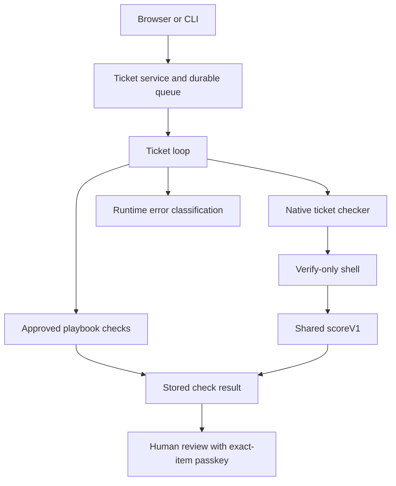

# Design facts

Observed at d8c0752; Graphify 0.9.92 code-only AST output, with source cross-checks. This is the current implementation, not the intended CORE-1 design.

## Components and data flow

- `apps/server/ticket-service.ts` composes `createTicketLoop`, playbook hooks and `createTicketChecker`. It also checks evidence freshness before a decision.
- `apps/server/ticket-loop.ts` invokes the configured checker, records results and decides whether correction is needed; its catch path classifies runtime failures independently of code-test failure.
- `apps/server/playbook-checks.ts` performs BASE admission, compares native results and incorporates quality findings. Its `check()` directly returns FAILED or PASSED WITH GAPS.
- `apps/server/ticket-checker.ts` delegates the native path to `apps/server/verify-only.ts`; `createVerifyOnly()` calls `scoreV1()` in `packages/shared/verification-v1.ts`.
- `packages/shared/verify-only-v2.ts` also has `scoreVerifyV2()`. Names alone must not be taken as evidence that all callers share one scoring path.
- Oracle execution, protected existing tests, recipes, quality checks, process cleanup and playbook admission supply facts upstream of those result decisions. Their function locations are in `artifacts/core1/graph/verdict-path-before.md`.

## Trust boundaries

The Builder runs separately from protected checks and private data. Checker adapters execute native tools in their restricted processes; report parsing and scoring do not make arbitrary Candidate code trustworthy. The event log stores observations, while fresh passkey confirmation and current evidence binding control human decisions. A graph edge is a source relation, not proof a boundary was enforced.

## Surprises and limits

There are two visible result construction paths (playbook and native), plus separate runtime-error handling. `scoreV1()` is also called by report validation (`isV1Report()`), not only by the verify-only shell; moving it requires preserving validation semantics. Historical scoring types/functions coexist with current ticket paths.

AST extraction reported a partial parse in `packages/shared/contracts.ts` and 75 files without extracted symbols, including `apps/server/main.ts`. Callback injection and indirect calls require source review; neither the graph nor a missing path proves exhaustive influence or purity. The future single-core extraction, lint rule and after-map are not implemented by this setup.

## Evidence

Before graph: `artifacts/core1/graph/before.html`; diagram: `before-overview.svg`; inventory: `verdict-path-before.md`; exact counts: `counts.json`; pinned setup and scan: `setup.json`, `skill-scan.json`; network observations: `network-audit.json`; actual denied connection attempts: `network-denial-proof.json`. No API keys, provider calls, MCP/HTTP server or application decisions were used.
