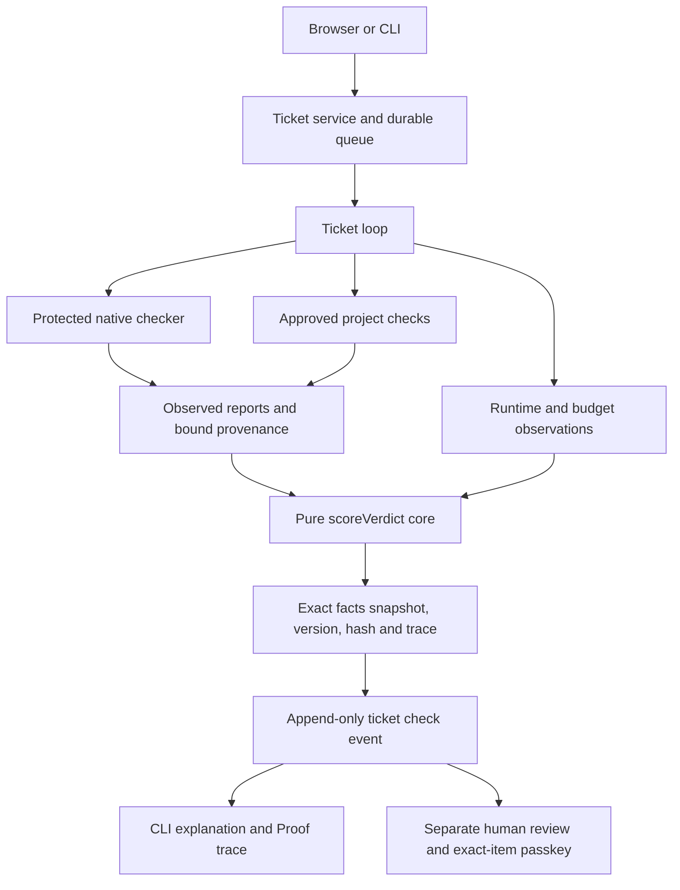
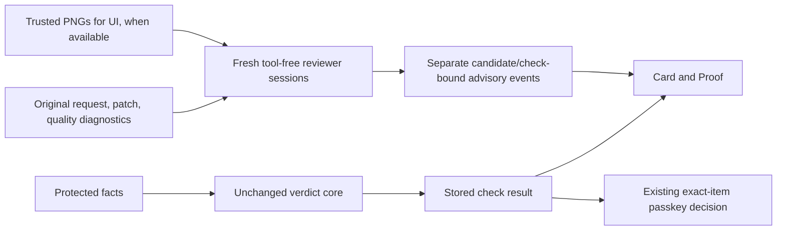
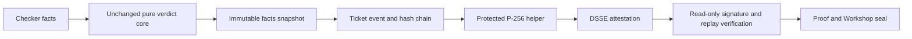

# Design facts

CORE-1 source at `14a6857`. Pre-refactor server/shared source in the original graph snapshot `d8c0752` is identical to `3c94150`. Graphify 0.9.92 supplies navigational AST relations, supplemented by source review and tests.



## Components and data flow

- `packages/shared/verdict-core.ts` is a 135-line pure module. `scoreVerdict` contains native and project aggregate rules, required-claim precedence, compatibility adaptation, their caution-order combination, runtime/budget classification and independent-test admission. `combineResults` delegates to the same function.
- `scoreV1`, `scoreVerifyV2`, ticket checker, project checker and runtime shell call this core. `isV1Report` checks structure only; public view validation explicitly checks semantic consistency through scoring.
- Collectors still execute tools, restore BASE tests, admit project commands, inspect quality/tamper reports, count usage and measure deadlines. Tool assertions, safe exports, process cleanup and human-review restrictions remain enforced outside the core.
- A supplied aggregate is accepted only on the internal native-ticket fact path, with protected-verifier ID and evidence-hash provenance. The live supplier is `createVerifyOnly` via create/createTicketCandidate/wait; historical replay reads its saved result. Builder prose is never a supplier. The empty-layer compatibility rule deliberately preserves old behavior; tightening it is proposed separately, not applied.
- `verdict-snapshot.ts` saves exact facts and core identity with content hashes and immutable files before publishing a production verdict. Snapshot failures cannot publish success. The evaluator bundle includes core and snapshot source, so policy changes invalidate existing freshness.
- `explainTicket` selects the highest-sequence check_result. CLI and Proof show that event number and its stored label; retained facts can explain current policy without changing historical labels. b15600b3's latest check is 664 (PASSED WITH GAPS), not 592 (NOT CHECKED). The earlier policy annotation remains separate.

## Trust boundaries

The Builder and protected checker remain separate processes with existing denial profiles. The pure core trusts its input observations; it cannot turn an untrusted in-process observation into a secure channel. Runtime, filesystem and process code never enter the core. Human Keep still needs current exact-item Touch ID and required diff viewing. Scoring never accepts a change on the owner's behalf. The provenance fields are origin metadata, not a signature.

## Measurements

The same dependency closure is 148 files / 3,982 edges before and 151 / 4,086 after. This includes collectors, types, observers and new snapshot/explanation shells. Source-reviewed aggregate decision authorities are separately 8 files / 8 functions before and 1 file / 1 deciding function after; delegation-only wrappers are excluded. See `artifacts/core1/graph/rule-authorities.json` for scope, entries and exclusions. Upstream layer constructors and diagnostic/admission checks are not claimed to have disappeared.

All 15 reconstructible historical results match actual 3c94150 code on identical facts. Four earlier events lack replay inputs; they remain historical records, not manufactured comparisons. The original golden archive and stored verdicts are unchanged.

## Graph and evidence limits

`before.html` / `after.html`, `before.png` / `after.png`, the readable overview images, manifests, counts and path-query output are under `artifacts/core1/graph/`. The core has no outgoing external import/call edges; the pinned TypeScript authority lint independently rejects imports and ambient side effects. Graphify's partial parsing and injected callbacks limit graph completeness; a missing edge is not an enforcement proof. CLI-only code extraction runs under deny-network, isolated HOME and no provider keys. The static skill scan was DO_NOT_INSTALL, so no Graphify skill or MCP/HTTP server was installed.

## REVIEW-1 advisory side channel

The protected verdict core, scorer wrappers and judge code retain their fbad889 hashes. After a check is recorded, the coordinator may schedule independent advisory reviewers. `DEFAULT_REVIEWERS` remains empty. REVIEW-1b uses the saved study only: both text reviewers flag the same five wrong study cases with zero false alarms, but no unique contribution beyond both Test Writer and quality gates is proven (gates were not measured). See REVIEWERS.md. Structurally valid out-of-patch notes are discarded individually; all-discarded output is Review incomplete. Discard events are advisory and excluded from decision bindings. `skipReviewers` is an optional approved-playbook opt-out; omitting it preserves existing hashes.



Reviewer output never enters core facts, review-risk colors, check evidence or decision binding. Each role has a 15,000-token budget and a separate fresh read-only session; no file/network/write tools are exposed. Missing screenshots or invalid output remain unavailable, not passing. Cancellation is separate from Builder budgets. The display channel is filtered from confirmation state solely to preserve existing bindings; all original state/check inputs remain authoritative. UI image transport was smoke-tested; the frozen study had no eligible visual patches and UI remains uncalibrated/off. The Workshop therefore retains its existing desks.

## SIGN-1 sealed records

- Verdict-core.ts is unchanged from fbad889. Both existing result paths still supply exactly the same facts and decisions.
- After a check result is recorded, the trusted host shell binds its event ID, stored facts/trace, core source, BASE, frozen diff and pinned gate-tool metadata into an in-toto Statement v1 / DSSE envelope. Only a successful signature emits verdict_sealed.
- Migration 21 adds a global ticket-event hash chain, its origin/head, attestation storage and seal-error storage. Pre-migration events retain their exact bytes and remain unsealed. Event, chain, seal and display marker publication use one SQLite savepoint.
- The current signer is a protected 0600 P-256 file fallback. The unsigned Swift/CryptoKit feasibility compile failed because Xcode's licence is unaccepted; no special entitlement or licence acceptance was added. Hardware feasibility remains unknown.
- The helper runs no Candidate code, receives only a bounded DSSE message, and has no network or agent-tool API. Real pinned Builder read/exec probes deny the key and helper (71-path corpus).
- Production verification pins docs/VERIFY_KEY.pem. Isolated TEST databases use isolated test keys. cc verify returns 0 only for sealed, replaying results; 1 for breaks; 2 for older/unsealed records. It is read-only and never accepts a change.
- Backup manifests and last-success checkpoints retain the chain head; SQLite replication retains its table. Facts, immutable diff bytes, signatures and signing identity are included in protected file checkpoints.
- Proof shows seal/replay status separately from the unchanged verdict. The Workshop wax press uses matching signed events plus the verified read-only detail status; missing state stays unknown and broken state is red.



A seal authenticates the stored result, including failures or gaps. It is not additional test coverage. Hash chains/signatures are checked against retained anchors and the trusted key; whole-machine rollback and an owner/root attacker replacing code/keys are outside this local boundary.

## SIGN-1b active hardware sealing

- Migration 21 is active on the owned local coordinator. Fresh backup and full restore were proven before activation; historical checks remain unsealed.
- The Swift CryptoKit helper signs with SecureEnclave.P256, AfterFirstUnlockThisDeviceOnly/privateKeyUsage, no biometric/user-presence requirement and no special entitlement. Only the device-bound blob is stored; Builder read and helper execution are denied.
- DSSE key IDs select public keys from docs/VERIFY_KEYS.json. Signed timestamps must fall within the selected key's validity interval. Retirement does not rewrite old envelopes or core verdicts.
- The local legacy private.pem was overwritten/fsynced/unlinked after hardware proof and restart. Exact private/blob backup paths are excluded; older backups/snapshots may retain the software key. Public keys remain available for historical verification on a new Mac.
- Key provisioning/rotation requires exclusive coordinator ownership. No verdict-core, scoring, approval, passkey or Keep rule changed.

## Bug from a log (BUG-1)

- A read-only production audit found zero seals from the retired software key. Its REVOKED status now rejects every timestamp; the historical metadata dates grant no validity. The hardware signer remains current.

- Ask detects a traceback; `./cc bug <file>` explicitly submits one. Bounded input is stripped of terminal controls and scanned by the existing Gitleaks and detect-secrets tools before storage or Codex. Detected lines are replaced wholesale; failed scanners reject intake.
- The first fresh Builder session has read-only BASE source and can write one pre-created reproduction file. The protected native runner independently runs that file on a fresh BASE archive. It must produce the same exception type, message and project file/function/line. Unsupported or mismatched traces stop with no fix session.
- Admission locks the test and BASE report outside the Builder. A second fresh session starts from BASE to implement the fix and is explicitly told its reproducer is already locked; it requests source changes rather than duplicate reproduction tests. Checking restores old tests and runs the locked reproduction against the frozen change. The pure core receives explicit reproduction bindings and the existing combined check result; failed guards never improve.
- New facts and trace are sealed through the existing attestation path. A fixed display event is emitted only after the passing check is persisted and sealed. Recheck uses the same frozen change and locks; missing or changed artifacts block Accept.
- Workshop scroll/jar/stamp and card/Proof text project these recorded events. The log is diagnostic data, not grader instructions. Touch ID and human decisions are unchanged.
- Initial support is conservative Python unittest with a normal unconditional test. Other runner traces, dynamic messages/frames or complex reproductions may be reported as not reproduced. Static Python shape screening is a tripwire, not a complete defense against malicious interpreter/result forgery.

BUG-1 measurement: four seeded faults reproduced and fixed, one unreproducible report stopped, zero false fixed. All four retain PASSED WITH GAPS (advisory writer and no dependency lockfile for OSV). Production activation preserves 19 older checks with zero broken seals. Details: [BUG-1 report](../artifacts/bug1/RESULT.md).

## Night Shift (NIGHT-1)

```text
One draft + exact repo/HEAD + approved playbook + budgets + absolute cutoff
  -> fresh existing passkey confirmation (2 minutes, one use)
  -> immutable delayed-Start consent in CC SQLite
  -> AC/window/aggregate allowance/ownership supervisor
  -> existing serial ticket queue -> existing Builder/checker/correction loop
  -> unchanged verdict core + fact snapshots + normal seal
  -> human review only (never Keep)
```

- `night_entries` stores immutable consent bindings and a single consumed ticket relation. `night_events` is append-only; both live in the existing builder-denied database. Pending entries do not create tickets or launch workers. The tables are initialized idempotently with the coordinator, like the existing passkey tables; historical schema versions, ticket rows and verdict records are not rewritten.
- The default local window is 01:00–07:00; approval stores absolute instants, so a DST transition cannot extend it. Each draft requires a separate current passkey assertion. Request/repo HEAD/playbook/approval/budget changes and morning expiry reject dispatch. No generic approval or scheduled Keep capability exists.
- The supervisor uses the existing serial queue, 300,000 total reported tokens by default, plus unchanged per-ticket limits (120,000 Builder / 40,000 Test Writer, 80 commands, 15 active minutes). It reserves enough allowance for the full next ticket before dispatch; it never silently extends a budget.
- macOS `pmset -g batt` must positively report AC. A coordinator-owned waiting helper is kernel-recorded before starting caffeinate; the helper and caffeinate are recorded with PID/birth/executable/group/session and reconciled when the shift ends. The parent pipe and bounded lifetime stop keep-awake after a coordinator crash. No shift means no keep-awake process.
- Only structured `usageLimitExceeded` / `rateLimitExceeded` notifications are retryable. Backoff is 60, 120, 240, 480, 900, 900 seconds, then stops. Retry reuses the same ticket/consent, preserves cumulative ticket usage and revalidates after cleanup. Ordinary errors never receive this automatic retry.
- STOP ALL or a tripwire ends the shift. Loss of AC, window end, stale consent, exhausted allowance, unknown cleanup or a supervisor gap over 15 seconds stops it. Mid-work restart does not replay consent. The ticket loop also checks the night authorization before launch/freeze and after checking, preventing a late successful response from becoming a pass.
- The morning report, optional fixed-text local notification, Workshop sign and sequential last-night replay derive from stored shift/ticket events. Replay uses the actual event time for lighting. The existing SSE stream carries updates; no browser polling was added.
- Pyright now receives the BASE export root (and BASE src layout) as execution environment/extraPaths, correcting the BUG-1 root-import false diagnostic without disabling type checks. This is an explicit gate-configuration correction; old facts/verdicts are unchanged.

- Unexpected Night supervisor/startup failures stop once, retain a diagnostic, interrupt pending consents and require inspection/restart; they are never retried every second. Night status changes and their audit event commit atomically.
- A verified buffered-frame race is corrected in the Builder supervisor: after a stop wins, later lifecycle callbacks cannot advance the ticket, while bounded raw frames and permission/RPC cleanup remain available. Watchman’s threshold and assertions are unchanged. Ownership helper failures retain a sanitized diagnostic for future diagnosis.

- Startup lifecycle and typed permission frames now share a private chronological buffer. Earlier command records are available before a queued denial, so exact terminal cleanup can be certified without weakening matching or accepting post-stop callbacks. A deterministic single-write regression covers it.
- A fresh explicit human Retry/Continue is marked only after the normal passkey requirement succeeds; it hands the ticket back to the ordinary loop rather than reusing expired night authority. Account-backoff retries never receive that mark. Night token accounting stops at this handoff and never resets automatically.
- Shift-end events freeze the results and reported cost. Later daytime retries/rechecks cannot rewrite last night’s report. Unreported Builder/Test Writer usage is recorded structurally; unknown usage stops the shift and is shown as unknown, not zero. A checker/worker harness error stops the shift rather than risking further unmeasured work.


## Versioned cores (CORE-2b)

The active policy is `verdict-core-v2` in `packages/shared/verdict-core.ts`. Released v1 is preserved at `packages/shared/cores/verdict-core-v1.ts`, byte-identical to main 4abc25a. `docs/CORE_VERSIONS.json` records source hashes, dates and changes. The shell registry uses fixed filenames, validates the recorded version/hash against metadata and actual file bytes on every replay, and executes those exact pure TypeScript sources with Node 24's built-in type stripping. The build packages the canonical sources and registry. New snapshots and seals use the current version; CLI and Proof replay historical seals through the recorded version. Unknown or edited sources are broken seals, never a fallback to the latest policy.

## SCION-1 scope rule

Add nothing that does not map to an in-scope attacker in [THREAT_MODEL.md](THREAT_MODEL.md) or to a real friction the owner has encountered. The host/OS remains trusted. No new source-control service, AI role or automatic repair agent is introduced.

- AST classification and the deterministic Proof summary address misleading Builder descriptions and difficult diff review; they do not assert semantic safety.
- Approved raise-only risk and project rules address disguised/sensitive edits and explicit architectural violations. Existing risk is always the floor.
- Weekly protected diagnostics address stale protection dates and observed environment failures. Stored observations, not constants, drive dated status.
- Extended seal provenance binds the exact request and the trusted Builder session associated with the frozen change. It does not authenticate model internals that the provider does not report.
