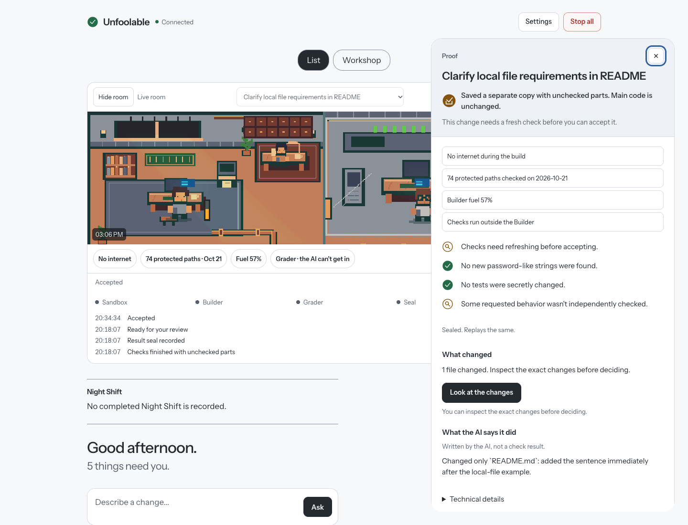

# Unfoolable

**AI does the work. It never grades itself.**

Unfoolable is a personal, local Mac app. Describe a code change, review the proposed task, and let Codex work in a separate copy. Protected checks report what passed and what could not be checked. You decide whether to Accept or Reject. Accept saves a separate local branch; it never merges or pushes.



*Stored task history and dated check results, not a claim about current live counts.*

## Start

Requirements: **macOS, Node 24, Git, and Codex authenticated with your existing ChatGPT account**. The sandbox and Touch ID flow are built for the Mac; this is not a cross-platform setup.

```sh
git clone https://github.com/jeshwanthsingh/Unfoolable.git
cd Unfoolable
npm ci
./cc chat
```

The launcher starts the coordinator, browser UI and live event stream, then opens your private page. On this Mac, the installed `unfool` alias does the same thing; cloning alone does not install that alias. Open the app through the launcher to connect the private screen.

Register your passkey in the local UI. Starting work and making decisions require fresh Touch ID confirmation; nothing is accepted automatically. Project checks need a one-time approved playbook. No new paid API billing is required; Codex uses your existing account allowance.

To investigate an error, paste its traceback in Ask, or run `./cc bug error.log`. Logs are bounded and scanned for secrets before AI sees them. The first session may only write a reproduction test; a fix starts only after that test produces the matching failure on the original code. Initial matching support is Python unittest. Unsupported or unreproduced reports stop honestly.

## Observatory

The main screen combines the live pixel room, your task list and a **Proof** pass. Open a task to see what was checked, what remains unchecked, the seal and the exact code changes. Accept still requires the existing review and fresh Touch ID. **Settings → Classic view** restores the previous list for this release.

The room follows recorded events: reading files, making changes, running checks and handing work to your desk. Its four pinned labels explain network restrictions, the dated protected-path probe, Builder fuel and the isolated Grader. Missing information stays unknown. Hover or focus a Proof fact to highlight its room object, or tap an object for its explanation and source.

**Replay** and its scrubber show a past task at an exact point in its saved history, with timing compressed. **Record clip** exports a local 16:9 or 9:16 WebM, labelled as replay. Nothing is uploaded. Opening live Proof cancels recording rather than mixing tasks. Chrome on Mac is the verified recorder; the demos below also include MP4 sharing copies.

A recorded tripwire or Stop all event opens a calm explanation with the task and time. The Night Shift briefing links completed work to its Proof; no report means no invented summary. A fresh seal gets one short shimmer. Four optional sounds are **off by default** and automatically muted during Night Shift. Hidden or offline rooms pause; reduced motion uses still pictures. The protected-path label is dated system evidence, not a count of secrets or a per-task guarantee.

Choose **Workshop** for the optional full-window room. Decorative ambient life is separate from recorded work. Neither replay nor the room can authorize a decision.

[Desktop and phone screenshots, light/dark](../artifacts/obs3/INDEX.md) · [16:9 demo](../artifacts/obs3/replay-landscape.mp4) · [9:16 demo](../artifacts/obs3/replay-portrait.mp4) · [Verification and limits](../artifacts/obs3/RESULT.md) · [Manual VoiceOver checklist](VOICEOVER_CHECKLIST.md).

## On your iPhone

Install and connect Tailscale on both devices using your own account. On the Mac run `./cc phone serve`, then open Settings → Add my phone. Scan the five-minute QR code, create the phone passkey, and confirm the matching phone on the Mac with Touch ID. Add the private HTTPS page to your iPhone Home Screen for optional alerts. The app stays on loopback; Tailscale Serve is private, never Funnel. Phone decisions require a fresh passkey check. [Phone setup and limits](PHONE_1.md).

## What the measurements say

| Measurement | Observed result |
| --- | --- |
| Planted cheats kept from passing | **12/12**: 5 failed, 7 inconclusive |
| False accepts on the eight-wrong-change scoring set | **0/8** |
| Correct changes confirmed by the earlier native Test Writer | **4/11** |
| Latest bounded-context confirmation study | **2/11 (18.2%)** |
| Six historical correct fixes confirmed | **1/6 (16.7%)** |

These are small local studies. Zero false accepts includes abstentions; it does not mean every defect was detected. The historical tasks are correlated, and four historical artifacts were blocked by the harness. The Test Writer missed its promotion bar and remains **advisory only**. [Measured results and limits](../artifacts/warning-signal/RESULT.md), [earlier native-test study](../artifacts/test-writer-v2/RESULT.md).

## Safety in six points

- The Builder uses an isolated copy, cannot read protected checks or private folders, and has no outside network.
- The checker restores the original tests before checking the frozen change. Edited tests cannot quietly replace them; zero tests never pass.
- Reusable project checks need approval. A regression check applies only if it passes on that change's starting version.
- The independent Test Writer sees original code, not the proposed change. Its warnings cannot erase a failing protected check.
- Accept needs a fresh Touch ID confirmation tied to the exact change. All work requires looking at every changed file; stale buttons are rejected.
- Work and decisions are recorded as events. Fixes are bounded, restart interrupts unfinished work, and Stop all needs no approval.

## Known limits

Passing existing tests does not prove new behavior. A result with unchecked behavior is a gap, not a clean bill of health. Native tests share a process with the code they test; deliberate in-memory or observation-channel forgery remains a risk. Tripwire alarms are best effort. There has been no full manual screen-reader audit. Physical-iPhone performance and a complete real-device pairing exercise are not established by desktop browser tests.

Backups are local and same-disk, not disaster protection. [Backup and restore](BACKUPS.md). The repository is still named `command-center`. Older orchestration screens are experimental. [Handoff](../HANDOFF.md) explains operation, tests and open work; [DESIGN.md](../DESIGN.md) is the design document.

Skill imports: `./cc skill add /absolute/path/to/a/skill` scans a frozen copy with the pinned local SkillSpector, static only and offline. High-risk imports remain uninstalled until an exact-content Touch ID confirmation. Existing skills rated “do not install” are disabled with files retained; see the UI-5b scan report. Static findings are warnings, not proof of malicious intent.

## Development and verification

```sh
npm run dev        # Local server and Vite frontend
npm test           # Automated tests; Node 24 required
npm run typecheck
npm run build
```

HTTP and process-ownership tests need an environment that permits local listeners and process inspection. Do not interpret sandbox-denied test infrastructure as a passing run. The completed Observatory verification passed **1,233/1,233 tests**, with no failures or skips, plus typecheck and production build. **61 golden replay comparisons had zero differences**; **281 protected implementation hashes and four decision callbacks were unchanged**. Axe reported **zero violations across 16 combinations** of main, Proof, Settings and room at desktop/phone widths, light/dark. A 30-second idle check recorded no work animations, counter changes or extra requests. These checks do not replace manual screen-reader or real-device testing. [Exact results](../artifacts/obs3/validation.json).

Vite is pinned to **8.3.5**; OSV and npm audit cleared the six baseline advisories. Protected-read probes and planted-cheat results are dated evidence, not checks automatically rerun when you clone. The current released inventory has **84 targets (`protected-paths-v2`)**; the 2026-10-25 Builder probe recorded **74 denied, 10 absent, zero readable**. **All 12 planted-cheat controls remained non-PASS**. [Probe](../artifacts/prelaunch-hardening/probe.json) · [Controls](../artifacts/obs3/negative-controls.json) · [Dependency scans and licenses](OBS_3_SOURCES.md).

Keep live SQLite data, local tools and credentials out of Git. Do not delete `.work/` wholesale: on the configured Mac it contains live application data. [Operational handoff](../HANDOFF.md) and [backup instructions](BACKUPS.md) cover the existing installation.

## Recovery snapshot — 2026-10-24

The latest activation verification found six sealed, eight older-unsealed and zero broken latest ticket records. Old seals replay registered core v1; new decisions use v2. Format-v2 seals bind the request hash and recorded Builder identity as well as the existing facts, trace and artifact bindings. SCION-1 adds syntax-based change classification, raise-only risk rules, approved project constraints and idle/AC-only weekly self-checks. The earlier Observatory test counts above remain historical. See [threat model](THREAT_MODEL.md), [ADV-1 status](ADV_1_STATUS.md) and [signing](SIGNING.md).

## Additional private paths

Set `COMMAND_CENTER_EXTRA_PROTECTED_PATHS` to a JSON array of absolute or `~/` paths before starting the coordinator, for example `COMMAND_CENTER_EXTRA_PROTECTED_PATHS='["~/.company-credentials"]' ./cc chat`. Absent paths are retained; symlink targets are also denied. Invalid/relative/control-character paths are rejected. Restart the coordinator normally for configuration changes to take effect. These entries supplement the immutable released manifest and are included in probe records; they cannot remove built-in protections. A private ancestor of an owned worktree fails closed instead of weakening its denial.

Tests use the pinned UI fixture described in [tests/README.md](../tests/README.md). Native Builder, browser and offline-quality integrations are explicit opt-ins, so a fresh clone does not need another personal repository.
